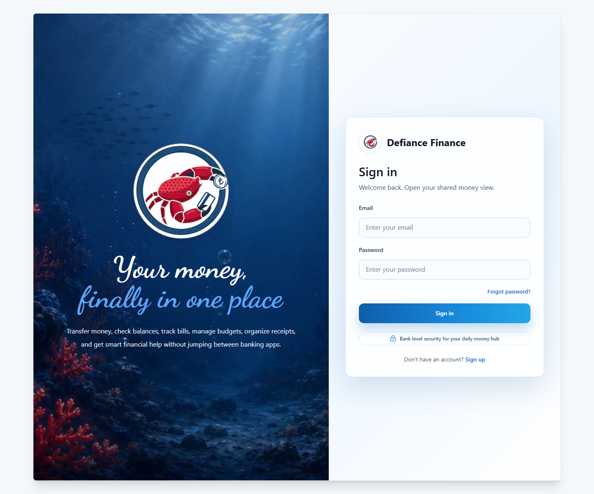
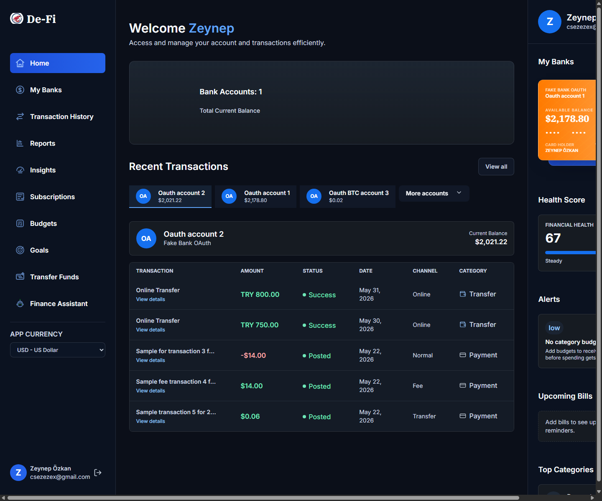
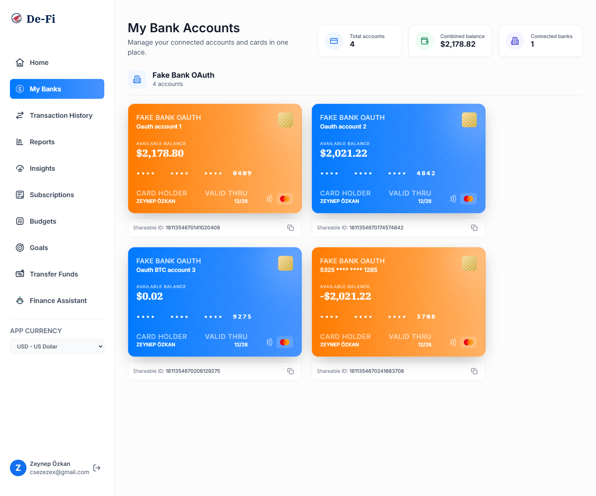
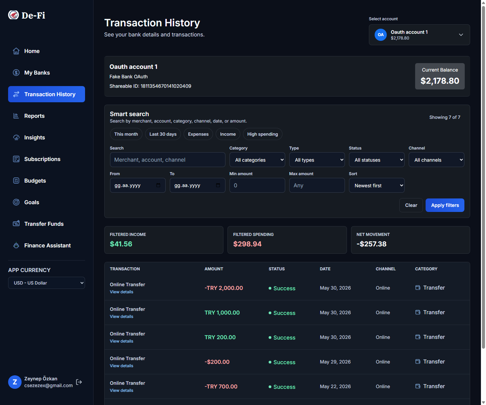
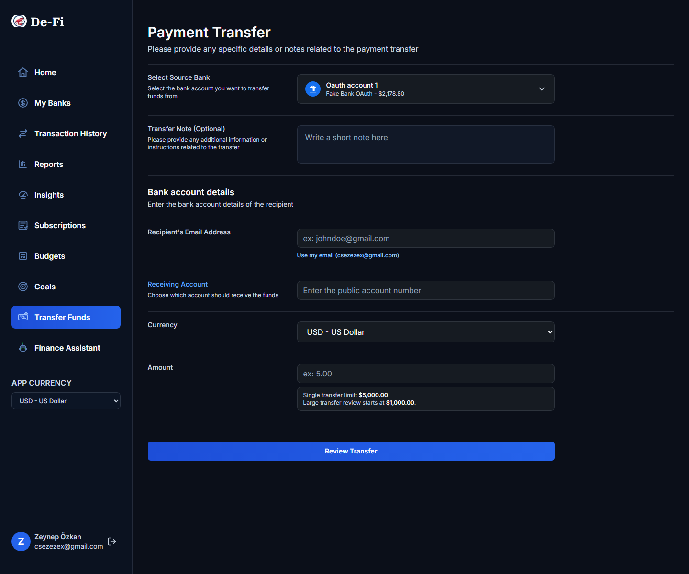
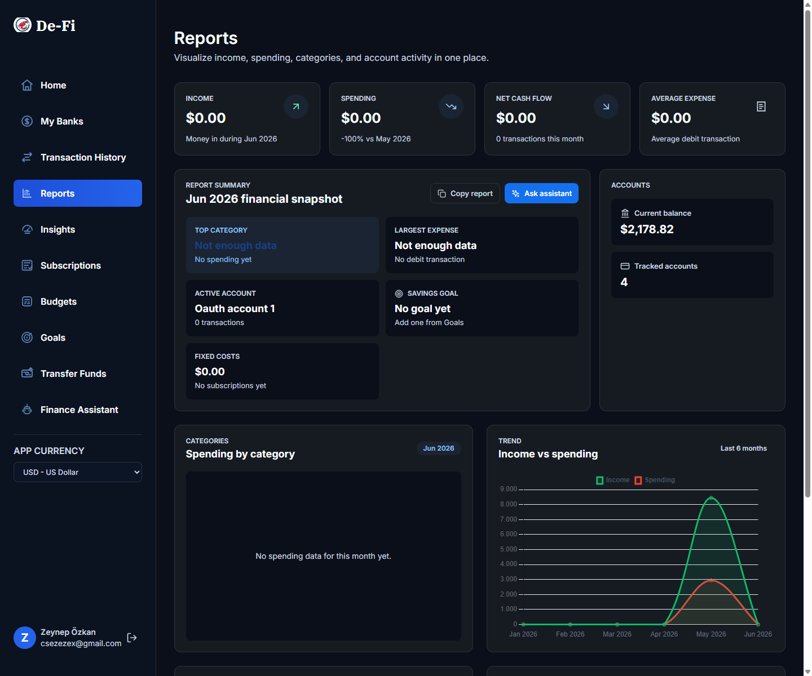
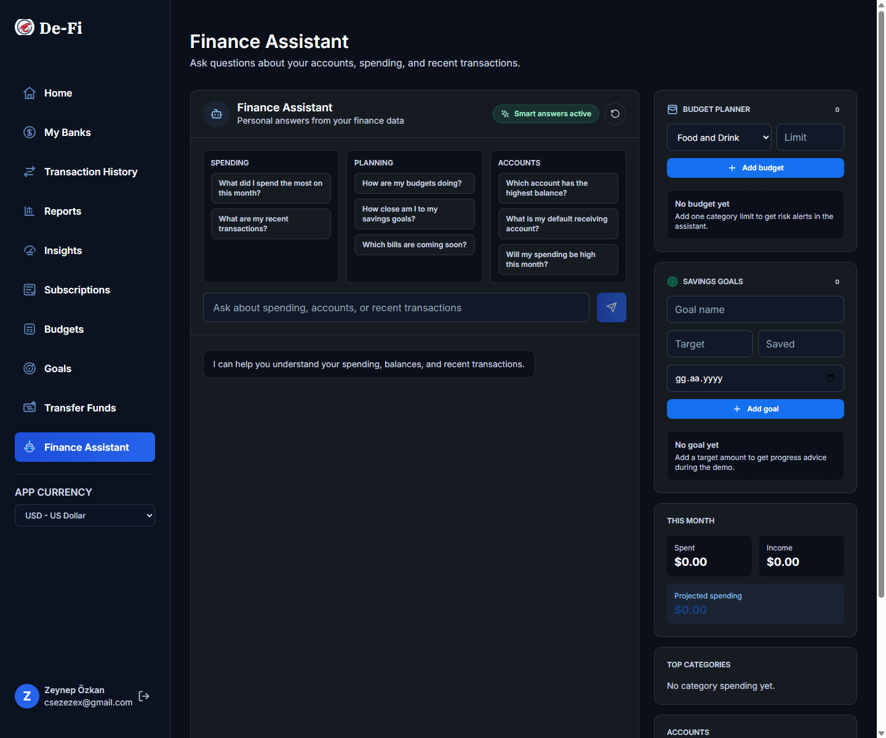
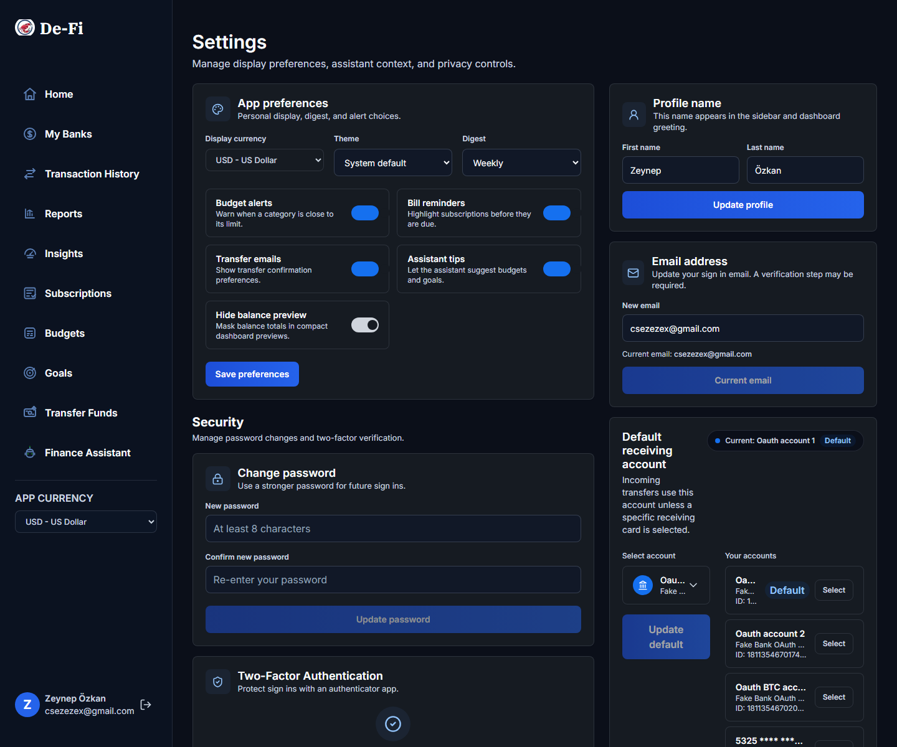

# Defiance Finance

Defiance Finance is a web-based personal finance MVP. It was developed as a senior project by Zeynep Özkan, Dila Ezgi Basım, and Ahmet Berat Bıçakçı.

The project helps a user see bank accounts, transactions, budgets, saving goals, subscriptions, reports, alerts, settings, and finance assistant support in one place. It is not a real bank and it does not give guaranteed financial advice. Its main aim is to make daily finance information easier to see, check, and use.

## Project Description

Many users follow money data from different places. They may use a bank app, a card statement, a spreadsheet, or notes for bills and budgets. This can become hard when the user has more than one account, regular payments, and saving goals.

Defiance Finance tries to solve this problem with one clear dashboard and related finance tools. The app supports:

- user sign up and sign in
- two-factor authentication
- connected bank account data
- dashboard summary
- transaction history with filters
- payment transfer review and checkout
- budgets and saving goals
- subscription tracking
- reports, insights, and alerts
- finance assistant answers based on app data
- profile, security, and account settings

## Final Report

The final project report is saved in the `zey rapor local` folder.

Direct report file:

[Defiance Finance Final Report.pdf](zey%20rapor%20local/Defiance%20Finance%20Final%20Report.pdf)

## Screenshots

| Sign In | Dashboard |
| --- | --- |
|  |  |

| My Banks | Transaction History |
| --- | --- |
|  |  |

| Payment Transfer | Reports |
| --- | --- |
|  |  |

| Finance Assistant | Settings |
| --- | --- |
|  |  |

## Installation

Run the project locally from the project folder.

1. Install dependencies.

```bash
npm install
```

2. Create a `.env.local` file in the project root.

Do not write real keys or private values in public files. The local environment file should include these variable names:

```env
NEXT_PUBLIC_SITE_URL=
NEXT_PUBLIC_SUPABASE_URL=
NEXT_PUBLIC_SUPABASE_ANON_KEY=
SUPABASE_SERVICE_ROLE_KEY=
SALT_EDGE_APP_ID=
SALT_EDGE_SECRET=
SALT_EDGE_BASE_URL=
NEXT_PUBLIC_STRIPE_PUBLISHABLE_KEY=
STRIPE_SECRET_KEY=
GEMINI_API_KEY=
```

3. Start the local development server.

```bash
npm run dev
```

For a different local port, for example port `3004`, run:

```bash
npm run dev -- -p 3004
```

4. Open the app in the browser.

```text
http://localhost:3000
```

or, if port `3004` is used:

```text
http://localhost:3004
```

5. Run tests.

```bash
npm test
```

## Architecture

The project uses Next.js App Router with React components and server-side actions.

High-level structure:

```text
Defiance-Finance/
|-- app/                  Next.js pages, layouts, and routes
|   |-- (auth)/            Sign in, sign up, 2FA, and recovery pages
|   |-- (root)/            Main app pages after sign in
|-- components/            Reusable UI components
|-- constants/             Static values and shared mappings
|-- docs/                  Project documentation
|-- hooks/                 Custom React hooks
|-- lib/                   Main app logic and helper functions
|   |-- actions/           Server actions for auth, banks, Stripe, and assistant
|-- public/                Static assets
|-- tests/                 Vitest test files
|-- types/                 TypeScript types
|-- middleware.ts          Supabase session middleware
|-- package.json           Dependencies and scripts
```

Main flow:

1. The user signs in through Supabase authentication.
2. Middleware and server actions check the session.
3. The protected app pages load account, transaction, and planner data.
4. Salt Edge is used for bank account and transaction connection.
5. Stripe is used for the checkout step in the transfer flow.
6. The finance assistant uses computed finance data first. Gemini can be used as a language layer when the API key is available.
7. Reports, insights, alerts, budgets, goals, and subscriptions use app utilities to prepare finance summaries.

## Datasets and Data Sources

No separate public dataset is included in this project.

The project uses these data sources:

- Supabase authentication and database records for users and saved data
- Salt Edge banking data for connected account and transaction information
- Stripe checkout data for transfer payment flow
- local demo and fallback data in `lib/demo-data.ts`
- browser storage for MVP planner data such as budgets, goals, subscriptions, and preferences

Real account data, private keys, passwords, and private environment values should not be committed.

## Third Party Tools

The project uses these main third-party tools and services:

| Tool | Use |
| --- | --- |
| Next.js | App Router, pages, layouts, server components, and server actions |
| React | User interface components |
| TypeScript | Type checking |
| TailwindCSS | Styling and responsive layout |
| Supabase | Authentication, MFA, sessions, and database work |
| Salt Edge | Bank account and transaction data connection |
| Stripe | Checkout step in the transfer flow |
| Gemini | Optional language layer for finance assistant answers |
| Sentry | Error monitoring |
| Chart.js | Charts in reports and summaries |
| Zod | Input validation |
| React Hook Form | Form state and submission handling |
| Vitest | Automated tests |
| LaTeX and Tectonic | Final report writing and local PDF compile |

## Security Notes

Finance data is sensitive. For this reason, the project uses protected sessions, two-factor authentication, server-side actions, validation, recipient checks, transfer review, and safer handling of private service values.

Private values must stay in `.env.local`. They should not be written in the README, report, screenshots, commits, or shared documents.

## Known Limits

This is an MVP, so it has limits:

- It is not a real bank.
- It does not give guaranteed investment, tax, or legal advice.
- Some planner data is stored in browser storage for the MVP.
- Some flows depend on third-party service availability.
- More end-to-end testing is needed for a production-level version.

## References

[1] Next.js App Router Documentation: https://nextjs.org/docs/app

[2] React Documentation: https://react.dev/

[3] TypeScript Handbook: https://www.typescriptlang.org/docs/handbook/intro.html

[4] TailwindCSS Documentation: https://tailwindcss.com/docs

[5] Supabase Documentation: https://supabase.com/docs

[6] Supabase MFA Documentation: https://supabase.com/docs/guides/auth/auth-mfa

[7] Salt Edge API Documentation: https://docs.saltedge.com/v6/api_reference/

[8] Stripe Checkout Documentation: https://docs.stripe.com/payments/checkout

[9] Gemini API Documentation: https://ai.google.dev/gemini-api/docs

[10] OWASP Top 10: https://owasp.org/Top10/

[11] NIST Digital Identity Guidelines: https://pages.nist.gov/800-63-4/sp800-63b.html

[12] Vitest Documentation: https://vitest.dev/guide/
